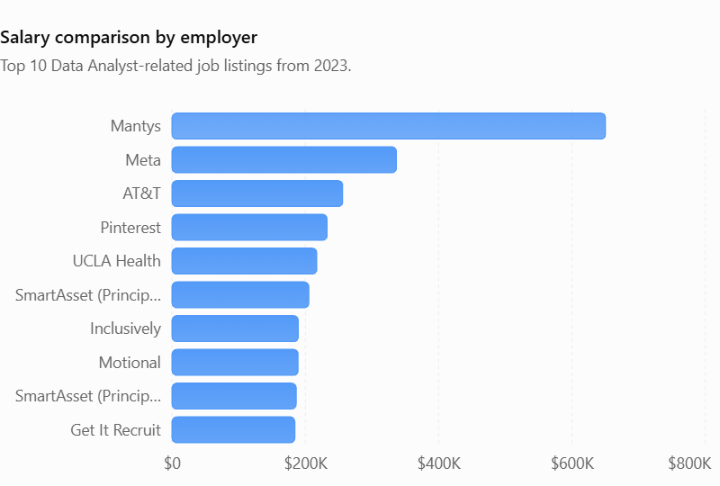

# Introduction

improve this: Diving into the data job market. Focsuin on data analyst roles, this project explores top-paying jobs, in-deman skills, and  where high deman meets high salary in data analytics

Explore the SQL queries used in this analysis: [project_sql_folder](/project_sql/) 

# Background
Driven by my interest in data analytics, I developed this project to explore the data job market and identify valuable career opportunities. The project focuses on identifying the highest-paying and most in-demand skills, helping job seekers make more informed career decisions and efficiently target opportunities that align with their skills and goals.

### The questions i wanted to answer throught my SQL queries were:

1. What are the top-paying data analyst jobs?

2. What skills are required for these top=paying jobs?

3. What skills are most in demand for data analysts ?

4. Which skills are associated with higher salaries?

5. What are the most optimal skills to learn ?

# Tools I Used

I used the following tool for my deep dive into the data job market

- **SQL: The foundation of my analysis , allowing me to query the database and derive critical insights.

- **PostgresSQL: The chosen database management system , ideal for handling the  job posting data.

- **Visual Studio Code: AN easy resource for managing databases and executing SQL queries

- **GIT & GitHub: They were used for version control and sharing my SQL querys and analysis, ensuring collaboration and project tracking.

# The Analysis

Every query used in this project for investigating specific areas of the data analst job market.

Here is how each question was executed:

### 1. Top Paying Data Analyst Jobs

To identify the highest-paying roles, i filtered data analyst postitions by average yearly salary and location, focusing on remote jobs. This query highlights the high paying opportunities in the field.

```sql

SELECT 

   job_id, 
   
   job_title, 
   job_location, 
   job_schedule_type, 
   salary_year_avg, 
   job_posted_date, 
   name AS company_name
FROM 

  job_postings_fact

  LEFT JOIN company_dim ON job_postings_fact.company_id = company_dim.company_id
  
  WHERE job_title_short = 'Data Analyst' AND job_location = 'Anywhere' AND  salary_year_avg IS NOT NULL
  
  ORDER BY salary_year_avg DESC LIMIT 10; 

  ```

  Key insights – Top-paying Data Analyst jobs in 2023
- High earning potential: Salaries among the top 10 listings ranged from $184,000 to $650,000 annually, indicating substantial earning potential in specialized analytics positions.

- Leadership pays more: Director-level positions at Meta ($336,500) and AT&T ($255,829) demonstrate the earning potential of analytics leadership and management roles.

- Experience matters: Principal Data Analyst positions appeared multiple times, with salaries between $186,000 and $205,000, suggesting that advanced experience and specialized expertise are valuable.

- Industry specialization: Marketing analytics at Pinterest ($232,423), healthcare analytics at UCLA Health ($217,000), and AV performance analysis at Motional ($189,000) demonstrate opportunities across different industries.

- Remote work opportunities: All 10 listings indicate "Anywhere" as their location, suggesting that remote opportunities were represented among the highest-paying positions.

- Full-time employment: All 10 positions were advertised as full-time, indicating that these high-paying opportunities primarily involved traditional full-time employment.



*Bar graph visualizing the salary for the top 10 salaries for data analysts; ChatGpt generated this graph from my SQL query results*


### 2. Skills for Top paying Jobs
To understand what skills are required for the top-paying jobs, i joined the  job postings with the skills data, providing employers value for high-compensation roles.

```SQL
WITH top_paying_jobs AS (

SELECT 

   job_id, 
   job_title, 
   salary_year_avg, 
   name AS company_name
FROM 

  job_postings_fact

  LEFT JOIN company_dim ON job_postings_fact.company_id = company_dim.company_id
  
  WHERE job_title_short = 'Data Analyst' AND 
  job_location = 'Anywhere' AND  salary_year_avg IS NOT NULL
  
  ORDER BY salary_year_avg DESC LIMIT 10

)

SELECT  
top_paying_jobs.*,
skills                     -- this will display the same columns selected in top_paying_jobs
FROM top_paying_jobs

INNER JOIN skills_job_dim ON top_paying_jobs.job_id = skills_job_dim.job_id   
INNER JOIN skills_dim ON skills_job_dim.skill_id = skills_dim.skill_id

ORDER BY  salary_year_avg DESC


```

Data Analyst Skills – Frequency Breakdown
Based on the 8 job postings:


| Skill     | Frequency | Percentage |
| --------- | --------- | ---------- |
| SQL       | 8         | 100%       |
| Python    | 7         | 87.5%      |
| Tableau   | 6         | 75%        |
| R         | 4         | 50%        |
| Excel     | 3         | 37.5%      |
| Pandas    | 3         | 37.5%      |
| Snowflake | 3         | 37.5%      |
| Azure     | 2         | 25%        |
| Power BI  | 2         | 25%        |
| Go        | 2         | 25%        |

Key takeaway: SQL, Python, and Tableau are the three most frequently requested skills. SQL appears in every posting, making it the most consistently requested skill in this dataset.


### 3. In-Demand Skills for Data Analysts


This query helped identify the skills mostly frequently requested in job postings, directing focus to areas with high deman skills for Data Analyst.
```SQL

SELECT skills , 
       COUNT(skills_job_dim.job_id) AS demand_count
FROM job_postings_fact

INNER JOIN skills_job_dim ON  job_postings_fact.job_id = skills_job_dim.job_id   
INNER JOIN skills_dim ON skills_job_dim.skill_id = skills_dim.skill_id

WHERE  
job_title_short = 'Data Analyst' AND job_work_from_home= True
  GROUP BY skills
ORDER BY
 demand_count DESC
LIMIT 5

```
Key Insights

- SQL dominates demand: Leads with 7,291 mentions, making database querying the most sought-after skill.

- Excel remains highly relevant: Ranks second with 4,611 mentions, highlighting the continued importance of spreadsheet analysis.

- Python is highly competitive: Ranks third with 4,330 mentions, demonstrating demand for programming and data manipulation.

- Visualization tools matter: Tableau (3,745) and Power BI (2,609) indicate strong demand for dashboard development and data visualization.

- Overall trend: Employers prioritize a combination of SQL, spreadsheet proficiency, programming, and data visualization skills.


| Rank | Skill    | Demand Count | Key Insight                         |
| ---- | -------- | ------------ | ----------------------------------- |
| 1    | SQL      | 7,291        | Highest employer demand             |
| 2    | Excel    | 4,611        | Essential spreadsheet skills        |
| 3    | Python   | 4,330        | Programming and data manipulation   |
| 4    | Tableau  | 3,745        | Data visualization and dashboards   |
| 5    | Power BI | 2,609        | Business intelligence and reporting |


### 4. Skills Based on Salary

Exploring the average salaries associated with different skills revealed which skills are the highest paying

```SQL
SELECT 

    skills , 
     ROUND ( AVG(salary_year_avg),0) AS avg_salary
FROM job_postings_fact

INNER JOIN skills_job_dim ON  job_postings_fact.job_id = skills_job_dim.job_id   
INNER JOIN skills_dim ON skills_job_dim.skill_id = skills_dim.skill_id

WHERE  
job_title_short = 'Data Analyst' 
AND salary_year_avg IS NOT NULL

 AND job_work_from_home= True
  GROUP BY
  
   skills
ORDER BY

 avg_salary DESC

LIMIT 25;


```


Key Insights

- Big Data & Distributed Computing: PySpark ($208K) leads the list, suggesting strong demand for processing and analyzing large-scale datasets.
- Cloud & Infrastructure: Databricks, GCP, Kubernetes, and Linux indicate that high-paying roles increasingly value cloud computing and scalable data environments.
- Programming & Data Science: Python libraries (Pandas, NumPy, Scikit-learn), Scala, and Go highlight the importance of programming, statistical analysis, and machine learning.
- Data Engineering: Airflow, PostgreSQL, Couchbase, and Elasticsearch point to the value of database management, data pipelines, and efficient data storage.
- Development & Collaboration: Bitbucket, GitLab, and Jenkins suggest that version control, automation, and collaborative development are valuable complementary skills.
- AI & Machine Learning: Watson and DataRobot indicate that AI integration and machine learning platforms are associated with higher-paying positions.
Overall trend: The highest-paying data analytics roles appear to favor candidates with a combination of advanced programming, big data processing, cloud infrastructure, and data engineering skills rather than just traditional reporting and visualization.

Notable observation: PySpark ($208,172) stands out significantly, suggesting that large-scale data processing is particularly valuable in this dataset.

Note: These are average salaries associated with job postings mentioning each skill.


| Category                                   | Salary ($) |
| ------------------------------------------ | ---------- |
| Big Data & Distributed Computing (PySpark) | 208172     |
| Development & Collaboration (Bitbucket)    | 189155     |
| Data Engineering (Couchbase)               | 160515     |
| AI & Machine Learning (Watson)             | 160515     |
| Programming & Data Science (Pandas)        | 151821     |
| Cloud & Infrastructure (Databricks)        | 141907     |


### 5. Most Optimal Skills to Learn
Combining insights from demand and salary data, this query aimed to pinpoint skills that are both in high deman and have high salaries, offering a strategic coucs for skill development.

```SQL
WITH skills_demand AS (
    SELECT
        skills_job_dim.skill_id,
        skills,
        COUNT(skills_job_dim.job_id) AS demand_count

    FROM job_postings_fact

    INNER JOIN skills_job_dim
        ON job_postings_fact.job_id = skills_job_dim.job_id

    INNER JOIN skills_dim
        ON skills_job_dim.skill_id = skills_dim.skill_id

    WHERE job_title_short = 'Data Analyst'
        AND job_work_from_home = TRUE
        AND salary_year_avg IS NOT NULL

    GROUP BY
        skills_job_dim.skill_id,
        skills
),

average_salary AS (
    SELECT
        skills_job_dim.skill_id,
        skills,
        ROUND(AVG(salary_year_avg), 0) AS avg_salary

    FROM job_postings_fact

    INNER JOIN skills_job_dim
        ON job_postings_fact.job_id = skills_job_dim.job_id

    INNER JOIN skills_dim
        ON skills_job_dim.skill_id = skills_dim.skill_id

    WHERE job_title_short = 'Data Analyst'
        AND salary_year_avg IS NOT NULL
        AND job_work_from_home = TRUE

    GROUP BY
        skills_job_dim.skill_id,
        skills
)

SELECT
    skills_demand.skill_id,
    skills_demand.skills,
    demand_count,
    avg_salary

FROM skills_demand

INNER JOIN average_salary
    ON skills_demand.skill_id = average_salary.skill_id

    WHERE demand_Count > 10
    
    ORDER BY demand_count DESC
     , average_salary DESC
    LIMIT 25;
```


Key insights
- SQL leads job demand: With 398 mentions, SQL is the most requested skill, followed by Excel (256), Python (236), and Tableau (230).

- Specialized skills command higher salaries: Go ($115,320), Hadoop ($113,193), Snowflake ($112,948), and Azure ($111,225) have some of the highest average salaries despite lower demand.

- Python and Tableau offer a strong combination: Both have substantial job demand and average salaries near or above $99,000, making them valuable skills for data analysts.

- Demand and salary do not always correlate: Excel ranks second in demand but averages $87,288, while less frequently requested skills such as Go and Snowflake have higher average salaries. SAS also appears twice with identical figures, likely reflecting duplicate skill records.


### Key insights

- SQL leads job demand: With 398 mentions, SQL is the most requested skill, followed by Excel (256), Python (236), and Tableau (230).

- Specialized skills command higher salaries: Go ($115,320), Hadoop ($113,193), Snowflake ($112,948), and Azure ($111,225) have some of the highest average salaries despite lower demand.

- Python and Tableau offer a strong combination: Both have substantial job demand and average salaries near or above $99,000, making them valuable skills for data analysts.

- Demand and salary do not always correlate: Excel ranks second in demand but averages $87,288, while less frequently requested skills such as Go and Snowflake have higher average salaries. SAS also appears twice with identical figures, likely reflecting duplicate skill records.

### Data Analyst skills: Demand and average salary

| Skill      | Demand Count | Average Salary ($) |
| ---------- | ------------ | ------------------ |
| SQL        | 398          | 97,237             |
| Excel      | 256          | 87,288             |
| Python     | 236          | 101,397            |
| Tableau    | 230          | 99,288             |
| R          | 148          | 100,499            |
| Power BI   | 110          | 97,431             |
| SAS        | 63           | 98,902             |
| SAS        | 63           | 98,902             |
| PowerPoint | 58           | 88,701             |
| Looker     | 49           | 103,795            |
| Word       | 48           | 82,576             |
| Snowflake  | 37           | 112,948            |
| Oracle     | 37           | 104,534            |
| SQL Server | 35           | 97,786             |
| Azure      | 34           | 111,225            |
| Sheets     | 32           | 86,088             |
| AWS        | 32           | 108,317            |
| Flow       | 28           | 97,200             |
| Go         | 27           | 115,320            |
| SPSS       | 24           | 92,170             |
| VBA        | 24           | 88,783             |
| Hadoop     | 22           | 113,193            |
| Jira       | 20           | 104,918            |
| JavaScript | 20           | 97,587             |
| SharePoint | 18           | 81,634             |

Note: Average salaries represent job postings mentioning each skill, not guaranteed salaries or the additional salary earned from possessing that skill.


# What I Learned

Throughout this journey, i have strenghtened my  SQL toolkit with challenging queries:

- **Complex Query Crafting:** I have advanced my SQL skills from beginner to intermediate, becoming more comfortable joining multiple tables and using CTEs to structure queries and retrieve data accurately.

- **Data Aggregation:** I have become comfortable working with aggregate functions such as COUNT(), COUNT(*), and other aggregation techniques to summarize data and identify meaningful patterns.

- **Analytical Skills:** This project provided an opportunity to strengthen my real-world problem-solving skills by translating questions into actionable insights through well-structured SQL queries.


# Conclustions


### Insights

1. - **Top Paying Data Analyst Jobs**: The highest-paying Data Analyst listings in 2023 offered salaries between $184K and $650K. Seniority, leadership, and industry specialization were common factors among these opportunities. All 10 listings were full-time and listed as remote ("Anywhere").

2. - **Skills for Top-Paying Jobs**: SQL, Python, and Tableau were the most frequently requested skills. SQL appeared in every posting, highlighting the importance of database querying in higher-paying analytics roles.

3. - **Most In-Demand Skills for Data Analysts**: SQL led employer demand with 7,291 mentions, followed by Excel, Python, Tableau, and Power BI. Employers value a combination of data querying, programming, spreadsheet analysis, and visualization.

4. - **Skills With Higher Salaries**: PySpark led the salary rankings at $208K, highlighting the value of big data processing. Cloud computing, data engineering, advanced programming, and machine learning technologies were also associated with higher-paying positions.

5. - **Optimal Skills for Job Market Value**: SQL, Excel, Python, and Tableau offered strong job demand, while specialized skills such as Go, Hadoop, Snowflake, and Azure showed higher average salaries. Combining foundational skills with specialized technical knowledge can improve career opportunities.


### Closing Thoughts

This project strengthened my problem-solving skills and improved my ability to write SQL queries to retrieve and analyze data. More importantly, it allowed me to apply what I have learned to a project directly connected to my career goals. By exploring the data analyst job market, I gained a better understanding of the skills employers value and the areas I need to continue developing. Although I still have much to learn on my journey toward becoming a Data Analyst, this project represents an important step forward in building my technical skills and preparing for future career opportunities.